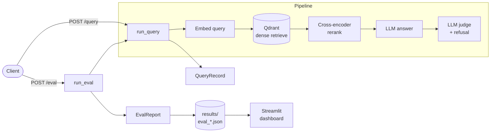

# RAGBench

A RAG **evaluation + observability platform** wrapped around a running retrieval-augmented-generation service. Every query returns not just an answer, but a full structured record — retrieved chunks and scores, rerank before/after, the judge verdict, and per-stage latency, tokens, and cost — and the same machinery runs over a dataset to produce a reproducible eval scorecard.

RAGBench began as a one-off benchmarking study (see [Experimental findings](#experimental-findings)) and is being grown into a living system: a config-driven service, structured per-query records, dataset-level evaluation, and a dashboard — the foundation that observability, richer metrics, and CI-gated eval build on.

---

## Architecture



Text view of the pipeline:

```
Dense retrieval (Qdrant + embeddings)
  → Optional cross-encoder reranking (BGE reranker)
  → LLM answer generation
  → LLM judge (faithfulness) + refusal gate
```

---

## The system

**Config-driven, reproducible runs.** A single pydantic `RunConfig` (loaded from `configs/query.yaml`) holds every setting — collection, embedding model, rerank on/off, answer/judge models, seed. Each config has a short SHA-256 `config_version` stamped onto every record, so any result traces back to the exact settings that produced it.

**`POST /query`** runs one question end to end and returns a full `QueryRecord`:
- retrieved chunks with dense scores, and the reranked set with both dense and rerank scores (the before/after of reranking)
- the answer and the faithfulness judge verdict (+ refusal flag)
- per-stage latency (embed / retrieve / rerank / answer / judge), token counts, and cost

**`POST /eval`** runs a whole dataset and returns an `EvalReport` — every per-item record plus an aggregate scorecard — and persists it to `results/eval_*.json` for the dashboard to read.

**Efficiency.** The embedder, Qdrant client, and reranker are built once and reused across calls (so a batch eval doesn't reload the reranker per item).

---

## Metrics

| Metric | Meaning |
|---|---|
| Faithfulness rate | Answer fully supported by retrieved context |
| Answer success rate | Answerable question answered correctly and not refused |
| False refusal rate | Answerable question wrongly refused |
| Hallucination rate | Unanswerable question answered instead of refused |
| Correct refusal rate | Unanswerable question correctly refused |
| Recall@k | Relevant chunk retrieved within top-k |
| Latency | Per-stage and end-to-end (ms) |
| Cost | Per query, answer + judge tokens |

> These reflect the current state and expand as the roadmap progresses (precision@k, MRR, NDCG, context precision/recall, judge calibration, and confidence intervals are planned — see [Roadmap](#roadmap)).

---

## Dashboard

A read-only Streamlit viewer (`dashboard/app.py`) over any saved `results/eval_*.json`: run picker, scorecard tiles, average latency by pipeline stage, answerable/unanswerable split, and a per-item drill-down table.

<!-- TODO: add dashboard screenshot once the full platform is complete -->

---

## Quickstart

```bash
# 1. Environment (keep the venv OUT of any cloud-synced folder, e.g. iCloud Desktop)
python -m venv ~/.venvs/ragbench
source ~/.venvs/ragbench/bin/activate
pip install -e .
pip install pyyaml streamlit pandas          # runtime extras

# 2. Set your key
cp .env.example .env                          # then add OPENAI_API_KEY

# 3. Start Qdrant
docker compose up -d

# 4. Index the demo corpus (creates the demo_k8s_helm collection)
python scripts/reindex_demo_docs.py           # verify script name/args for your setup

# 5. Run the service
uvicorn ragbench.api.service:app --port 8000
#   POST /query  {"question": "How do Helm charts use values.yaml?"}
#   POST /eval   {"dataset_path": "benchmarks/sample.jsonl"}
#   docs at http://localhost:8000/docs

# 6. (Optional) Run an eval from the CLI
python scripts/run_benchmark.py

# 7. Launch the dashboard
streamlit run dashboard/app.py
```

### Configuration

`configs/query.yaml` controls a run:

```yaml
seed: 42
retrieval:
  collection: demo_k8s_helm
  embed_model: text-embedding-3-small
  embed_kind: openai            # "openai" or "local"
  dense_top_k: 10
rerank:
  enabled: true
  model: BAAI/bge-reranker-base
  top_n: 3
answer:
  model: gpt-4.1-mini
judge:
  model: gpt-4.1-mini
```

Point the service at a different config with `RAGBENCH_CONFIG=path/to.yaml`.

---

## Roadmap

The platform is organized into five workstreams:

1. **Eval breadth** — precision@k, MRR, NDCG@k; context precision/recall; answer relevance + correctness; citation accuracy. *(planned)*
2. **Eval rigor** — LLM-judge calibration vs. human labels (Cohen's κ); bias controls + pairwise judging; bootstrap confidence intervals; versioned, difficulty-stratified dataset; adversarial slices. *(planned)*
3. **Observability** — per-stage tracing; Prometheus + Grafana ops metrics; structured logging with per-query correlation IDs; quality + drift over time. *(planned)*
4. **Eval-in-lifecycle** — eval suite in CI gating merges on thresholds; experiment tracking; online eval sampling of live queries. *(planned)*
5. **System packaging** — FastAPI `/query` ✅ + `/eval` ✅; config-driven reproducible runs ✅; Streamlit dashboard ✅; README + architecture diagram ✅.

---

## Experimental findings

> From the original benchmarking study. Preserved as the empirical baseline the platform is built to extend.

**Key insight:** RAG systems are often **recall-limited, not ranking-limited.** If dense retrieval fails to surface the correct chunk, reranking cannot fix the problem — it only adds latency.

**Experiments**

1. **Dense vs. dense+rerank ablation** — measured recall@k, latency, and hallucination across `text-embedding-3-large` (OpenAI, 3072-dim) and `bge-small-en-v1.5` (local). Reranking added ~2–3× latency without recall improvement in small corpora, pointing to a dense-retrieval bottleneck.
2. **Threshold gating (safety vs. utility)** — higher `tau_dense` / `tau_rerank` thresholds reduced hallucination but increased false refusals, as borderline queries got gated and coverage dropped.
3. **LLM comparison** — benchmarked GPT-4.1-mini, GPT-4o, GPT-5.1. Faithfulness stayed high; reasoning-heavier models showed higher false refusal under strict gating.

**Empirical observations**
- Reranking does not improve recall if dense retrieval misses relevant chunks within top-k.
- Reranking significantly increases latency (~400–600 ms per query).
- Local embeddings give large latency gains but may degrade recall at scale.
- Strict gating reduces hallucination but increases false refusal.
- Reasoning-heavy LLMs may over-refuse when context confidence is low.